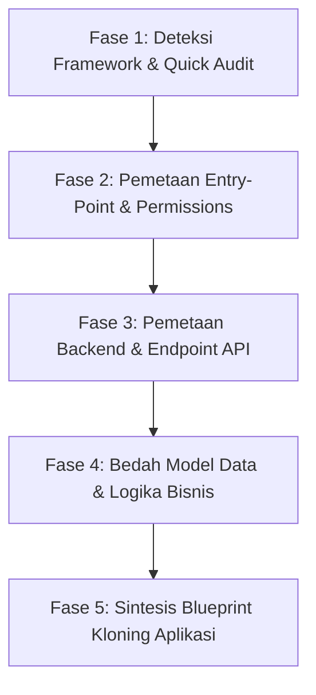

# Android APK Reverse Engineering & Blueprint Synthesis (apkx)

Tujuan utama skill ini adalah memandu AI Agent dalam menganalisis berkas APK/APKS hasil ekstraksi `apkx` secara metodis, mengekstrak arsitektur inti aplikasi, menemukan endpoint API backend, dan menyusun cetak biru (*blueprint*) yang siap diimplementasikan ulang (dikloning) ke framework modern seperti **Flutter**, **React Native**, atau **Kotlin Clean Architecture**.

---

## 1. Prinsip Utama: Clean-Room Reverse Engineering

1. **Evidence-Based (Berbasis Bukti):** Jangan pernah menebak struktur data, endpoint API, atau logika bisnis jika Anda bisa memverifikasinya langsung dari artefak `apkx` (Manifest, `endpoints.json`, `class_skeleton.txt`, atau dekompilasi JADX).
2. **Precision Over Context Bloat (Fokus & Presisi):** Jangan membaca seluruh file dump raksasa jika tidak diperlukan. Gunakan tool pencarian terarah seperti `apkx_find_classes` dan `apkx_search_endpoints` untuk menemukan jarum di tumpukan jerami.
3. **Clean-Room Reimplementation:** Hasil reverse engineering digunakan sebagai acuan arsitektur (kontrak API, model data, dan alur UI), kemudian dibangun ulang secara bersih menggunakan standar dan *best practices* framework target (misalnya menerapkan *Flutter Anti-Slop*).

---

## 2. Alur Investigasi 5 Langkah (5-Phase Workflow)

---

### Fase 1: Deteksi Framework & Quick Audit
Sebelum memeriksa kode secara mendalam, kenali teknologi dasar aplikasi target:

1. **Jalankan `apkx_get_app_info(package_name)`** untuk melihat:
   * `targetSdk`, `minSdk`, dan versi aplikasi.
   * Format aplikasi (Single APK vs Split-APK/App Bundle).
2. **Periksa Framework Terdeteksi di `README_ANALISIS.txt` atau hasil `apkx_pull_and_extract`:**
   * **Flutter:** Memiliki `libflutter.so` dan `libapp.so`.
     * *Catatan Penting:* Logika aplikasi berada di compiled native AOT `libapp.so`. DEX hanya berisi wrapper Java. Jangan habiskan waktu mendekomposisi DEX untuk UI Flutter; fokuslah pada string URL di `endpoints.json` dan resource asset di `assets/flutter_assets/`.
   * **React Native:** Memiliki `index.android.bundle` (Hermes bytecode `.hbc` atau Plain JS).
     * Fokus pada pemetaan URL, nama rute komponen, dan state schema dari bundle JS.
   * **Java/Kotlin Native:** Menggunakan pure DEX bytecode multi-split.
     * Kode sumber Java/Kotlin dapat didekomposisi sempurna secara selektif via `apkx_inspect_class`.

---

### Fase 2: Pemetaan Entry-Point & Permissions
Gunakan tool **`apkx_get_manifest(target_path)`** untuk membaca `AndroidManifest_readable.xml`:

1. **Cari Main Launcher Activity:**
   * Temukan `<activity>` yang memiliki filter `<action android:name="android.intent.action.MAIN"/>` dan `<category android:name="android.intent.category.LAUNCHER"/>`. Ini adalah halaman pertama saat aplikasi dibuka (Splash Screen atau Login Activity).
2. **Identifikasi Deep Links & Navigasi URL:**
   * Periksa `<data android:scheme="..." android:host="..."/>` untuk mengetahui skema URL routing aplikasi.
3. **Audit Izin (*Permissions*):**
   * Catat permission sensitif (`CAMERA`, `ACCESS_FINE_LOCATION`, `POST_NOTIFICATIONS`, `READ_CONTACTS`) yang diperlukan jika ingin mengkloning fitur terkait.

---

### Fase 3: Pemetaan Backend & API Endpoints
Gunakan tool **`apkx_search_endpoints(target_path, query=...)`**:

1. **Cari Domain Utama:**
   * Panggil `apkx_search_endpoints(target_path)` untuk melihat daftar seluruh domain yang terdeteksi. Identifikasi base URL backend utama aplikasi vs domain pihak ketiga (Firebase, Facebook, Google Analytics, Sentry).
2. **Cari Endpoint Fitur Tertentu:**
   * Otentikasi: `apkx_search_endpoints(target_path, query="auth")` atau `query="login"`.
   * API Versi: `apkx_search_endpoints(target_path, query="/v1/")` atau `query="/v2/"`.
   * Fitur Utama (Produk/Cart/User): `apkx_search_endpoints(target_path, query="product")`, `query="user"`, atau `query="cart"`.
3. **Formatkan Hasil ke Tabel Kontrak API:**
   * Metode (GET/POST/PUT)
   * URL Path
   * Perkiraan Payload / Response Body

---

### Fase 4: Bedah Model Data & Logika Bisnis (Java/Kotlin Native)
Jika aplikasi berbasis Java/Kotlin:

1. **Cari Kelas Relevan dengan `apkx_find_classes(target_path, query=...)`:**
   * Contoh: mencari kelas login `apkx_find_classes(target_path, query="login")`.
   * Contoh: mencari repository `apkx_find_classes(target_path, query="repository")`.
   * Contoh: mencari model data `apkx_find_classes(target_path, query="model")`.
2. **Dekomposisi On-Demand dengan `apkx_inspect_class(target_apk, class_name)`:**
   * Panggil dekompilasi JADX hanya untuk kelas kunci yang ditemukan (misal: `com.example.app.data.model.UserResponse`).
   * Salin nama field, tipe data, dan anotasi serialized name JSON (misal `@SerializedName("user_id")`).

---

### Fase 5: Sintesis Blueprint Kloning Aplikasi
Setelah data terkumpul, susun laporan Blueprint Arsitektur untuk pengguna dengan struktur berikut:

1. **Ringkasan Identitas Aplikasi:**
   * Nama, Package ID, Framework asal.
2. **Pohon Arsitektur Fitur (Feature Architecture):**
   * Modul Auth (Login, Register, OTP).
   * Modul Utama (Dashboard/Home, Catalog, Detail, Settings).
3. **Kontrak API & Model Data:**
   * Daftar endpoint yang siap dibuatkan service HTTP-nya di framework baru.
   * Model data (Entity / DTO) lengkap dengan field dan tipe data.
4. **Rancangan Implementasi di Framework Target (misal Flutter):**
   * State Management yang disarankan (Bloc / Riverpod).
   * Struktur folder (Data Layer, Domain Layer, Presentation Layer).
   * Desain UI mengikuti kaidah UX terbaik (*Thumb Zone*, 48dp hit targets, 4-state architecture: Shimmer, Empty, Error with Retry, Success).

---

## 3. Contoh Skenario Interaksi

**User:** *"Tolong analisa aplikasi Instagram di HP saya menggunakan apkx, saya ingin tahu bagaimana endpoint feed-nya bekerja dan buatkan model data Flutter-nya."*

**Langkah Agent:**
1. Panggil `apkx_pull_and_extract("Instagram")`.
2. Panggil `apkx_search_endpoints(extracted_dir, query="feed")` untuk menemukan endpoint feed.
3. Panggil `apkx_find_classes(extracted_dir, query="feedresponse")`.
4. Panggil `apkx_inspect_class(apk_path, "com.instagram.feed.model.FeedResponse")`.
5. Tuliskan kelas model Dart/Flutter lengkap dengan `fromJson` dan `toJson` berdasarkan schema asli yang terbukti dari hasil dekompilasi.
