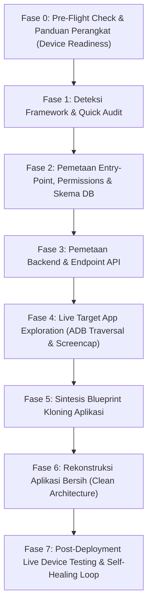

# Android APK Reverse Engineering, Live UI Traversal & Blueprint Synthesis (apkx)

Tujuan utama skill ini adalah memandu AI Agent dalam menganalisis berkas APK/APKS hasil ekstraksi `apkx` secara metodis, mengekstrak arsitektur inti aplikasi, memetakan skema database (termasuk SQLite di `libapp.so`), menjelajahi seluruh fitur UI aplikasi target secara langsung di ponsel melalui ADB (*screencap & tap*), menyusun cetak biru (*blueprint*) arsitektur, dan memverifikasi aplikasi hasil kloningan langsung di perangkat fisik dengan siklus perbaikan mandiri (*Self-Healing Loop*).

---

## 1. Prinsip Utama: Clean-Room Reverse Engineering & Verification

1. **Evidence-Based (Berbasis Bukti):** Jangan pernah menebak struktur data, endpoint API, atau logika bisnis jika Anda bisa memverifikasinya langsung dari artefak `apkx` (Manifest, `endpoints.json`, `class_skeleton.txt`, `sqlite_schema.sql`, atau dekompilasi JADX).
2. **Live Visual Grounding (Eksplorasi Layar Nyata):** Blueprint statis tidak menggambarkan alur UX secara utuh. Buka aplikasi target di ponsel via ADB, ambil screenshot untuk tiap tab dan modal, lalu gunakan penalaran visual multimodal AI untuk mengidentifikasi tata letak, warna, dan kelemahan UI aplikasi asli.
3. **Clean-Room Reimplementation:** Hasil reverse engineering digunakan sebagai acuan arsitektur (kontrak API, model data, dan alur UI), kemudian dibangun ulang secara bersih menggunakan standar framework target (misalnya menerapkan *Flutter Anti-Slop*).
4. **Autonomous Runtime Verification (Self-Healing):** Jangan anggap pekerjaan selesai sebelum aplikasi yang dibangun berhasil diinstall ke HP dan diuji coba langsung. Jalankan simulasi interaksi (tap, form input, submit) dan segera perbaiki jika ditemukan error atau glitch visual.

---

## 2. Alur Kerja Utama 8 Fase (8-Phase Master Workflow)

---

### Fase 0: Pre-Flight Check & Panduan Perangkat (Device Readiness)
Sebelum mengeksekusi operasi perangkat apa pun (seperti `apkx_list_apps`, `apkx_pull_and_extract`, atau live UI traversal), AI Agent **WAJIB** memverifikasi kesiapan perangkat:

1. **Jalankan Pre-Flight Check:**
   Panggil tool **`apkx_list_devices()`**.
   Tool ini memeriksa koneksi ADB dan mengembalikan status kesiapan:
   * **`status == "ready"` (`code == "READY"`):** Perangkat terhubung, diizinkan, dan siap digunakan. Agen dapat melanjutkan langsung ke Fase 1.
   * **`code == "NO_DEVICE"`:** Tidak ada perangkat Android atau emulator yang terdeteksi via ADB.
   * **`code == "UNAUTHORIZED"`:** Perangkat terhubung namun belum diizinkan (menunggu konfirmasi otorisasi RSA di layar HP).
   * **`code == "OFFLINE"`:** Perangkat terhubung namun berstatus offline.

2. **Protokol Agen Jika Perangkat Tidak Terdeteksi (`NO_DEVICE`):**
   * **JANGAN** melanjutkan ke langkah ekstraksi/analisis perangkat atau memanggil tool ADB lainnya.
   * **JANGAN** mengeluarkan pesan error mentah teknis (`ADBError: no devices found`).
   * **Sampaikan pesan panduan ramah, jelas, dan santun** kepada pengguna dengan 4 langkah berikut:
     > "Halo! Saya mendeteksi belum ada perangkat Android yang terhubung via ADB. Agar proses analisis atau pengujian aplikasi dapat berjalan langsung di ponsel, mohon ikuti 4 langkah cepat berikut:
     > 1. Hubungkan HP Android ke komputer menggunakan kabel data USB (atau jalankan emulator Android).
     > 2. Aktifkan **Opsi Pengembang (Developer Options)** dan hidupkan **USB Debugging** di Pengaturan HP.
     > 3. Buka layar HP dan periksa dialog USB Debugging lalu pilih **Izinkan / Allow** (centang 'Selalu izinkan dari komputer ini').
     > 4. Balas chat ini dengan *'sudah siap'* atau hubungi saya kembali jika perangkat sudah terpasang.
     >
     > *(Catatan: Jika Anda sudah memiliki file APK di komputer, Anda juga bisa memberikannya langsung kepada saya untuk dianalisis secara offline tanpa HP!)*"

3. **Protokol Agen Jika Perangkat Belum Diizinkan (`UNAUTHORIZED`):**
   * Minta pengguna membuka kunci layar ponsel dan menekan tombol **"Allow / Izinkan"** pada dialog konfirmasi USB Debugging.

---

### Fase 1: Deteksi Framework & Quick Audit
Sebelum memeriksa kode secara mendalam, kenali teknologi dasar aplikasi target:

1. **Jalankan `apkx_get_app_info(package_name)`** untuk melihat:
   * `targetSdk`, `minSdk`, versi aplikasi, dan lokasi file APK di ponsel.
   * Format aplikasi (Single APK vs Split-APK/App Bundle).
2. **Tarik dan Ekstrak Berkas via `apkx_pull_and_extract(query_or_package)`**:
   * Periksa Framework terdeteksi di `README_ANALISIS.txt` atau `analysis_info.json`:
     * **Flutter:** Memiliki `libflutter.so` dan `libapp.so`. Logika di compiled native AOT `libapp.so`.
     * **React Native:** Memiliki `index.android.bundle` (Hermes bytecode `.hbc` atau Plain JS).
     * **Java/Kotlin Native:** Menggunakan pure DEX bytecode multi-split.
     * **Unity:** Game berbasis engine Unity (`libunity.so` / `bin/Data`).

---

### Fase 2: Pemetaan Entry-Point, Permissions & Skema Database

1. **Baca Manifest Terdekode (`apkx_get_manifest(target_path)`):**
   * Cari **Main Launcher Activity** (`android.intent.action.MAIN` + `android.intent.category.LAUNCHER`) untuk mengetahui entry point saat aplikasi diluncurkan.
   * Identifikasi Deep Links & skema URL (`<data android:scheme="..." android:host="..."/>`).
   * Audit izin (*permissions*) sensitif (`CAMERA`, `ACCESS_FINE_LOCATION`, `POST_NOTIFICATIONS`).
2. **Ekstraksi Skema Database (SQLite / ORM):**
   * Gunakan tool **`apkx_extract_sqlite_schema(target_path)`** atau periksa `sqlite_schema.sql`.
   * Pada aplikasi Flutter, tabel-tabel SQLite (`account`, `category`, `transaction`, `user`, dll.) tertanam dalam biner `libapp.so` dan otomatis terekstrak ke file `sqlite_schema.json`.

---

### Fase 3: Pemetaan Backend & API Endpoints

Gunakan tool **`apkx_search_endpoints(target_path, query=...)`**:
1. **Cari Domain Utama:** Identifikasi base URL backend utama aplikasi vs domain analitik pihak ketiga.
2. **Cari Endpoint Fitur:**
   * Otentikasi: `query="auth"` atau `query="login"`.
   * API Versi: `query="/v1/"` atau `query="/v2/"`.
   * Fitur Utama: `query="user"`, `query="product"`, `query="transaction"`.
3. Formatkan ke dalam tabel kontrak API (Metode, URL, Perkiraan Payload).

---

### Fase 4: Live Target App Exploration (ADB Traversal & Screencap)
Buka aplikasi target di HP yang terhubung untuk memetakan seluruh antarmuka dan menangkap cacat desain aplikasi asli:

1. **Pastikan Layar Menyala & Tidak Terkunci:**
   * Panggil tool **`apkx_ensure_device_awake()`** terlebih dahulu. Tool ini mengaktifkan mode *Stay Awake via USB*, membangunkan layar, dan membuka kunci swipe/PIN otomatis. Jika ponsel terkunci PIN dan PIN belum diset, tool akan mengembalikan status peringatan agar Agen tidak melakukan tap sembarangan ke keypad lockscreen.
2. **Buka Aplikasi Target & Cek Layar Aktif:**
   * Panggil tool **`apkx_launch_app(package_name, restart=True)`**.
   * Verifikasi Activity yang sedang tampil di layar menggunakan **`apkx_get_current_screen()`** untuk memastikan aplikasi berhasil berada di latar depan (*foreground*).
3. **Ambil Tangkapan Layar Berkecepatan Tinggi:**
   * Panggil **`apkx_take_screenshot(output_path="output/screen_target_home.png")`** (atau `adb exec-out screencap -p > output/screen_target_home.png`).
   * Baca file gambar menggunakan tool `Read` untuk penalaran visual multimodal.
4. **Penjelajahan Matriks Antarmuka Sistematis (Full Feature Traversal):**
   * **Bottom Navigation Bar:** Berpindah ke setiap tab dengan memanggil `apkx_interact(action="tap", x=..., y=...)` dan ambil screenshot untuk setiap tab:
     * `screen_target_tab_transaksi.png`
     * `screen_target_tab_bagan.png`
     * `screen_target_tab_akun.png`
     * `screen_target_tab_setelan.png`
   * **Floating Action Button (FAB / +):** Tap tombol tambah aksi untuk menangkap form transaksi / modal dialog (`screen_target_add.png`).
   * **Drawer Menu / Header:** Tap menu samping atau filter tanggal di header atas.
   * **Inspeksi Bounding Box Presisi:** Jika butuh koordinat pasti tombol teks, panggil **`apkx_dump_ui_hierarchy()`** untuk mendapatkan koordinat tengah `[center_x, center_y]` dari elemen target.
   * **Navigasi Kembali Aman:** Gunakan `apkx_interact(action="back")` (atau `adb shell input keyevent 4`) untuk menutup dialog/keyboard.
5. **Audit Kelemahan UI/UX Aplikasi Asli:**
   Catat kelemahan visual aplikasi target untuk diperbaiki pada aplikasi baru:
   * *Kontras Buruk:* Teks gelap di atas background gelap (tidak lolos WCAG AAA).
   * *Teks Terpotong:* Label teks panjang yang terpotong secara canggung.
   * *Tabrakan Elemen:* Tombol melayang yang menutupi kartu atau form input.
   * *Dead Space:* Ruang kosong masif yang tidak dimanfaatkan.

---

### Fase 5: Sintesis Blueprint Kloning Aplikasi
Susun dokumen ringkasan Blueprint Arsitektur:
1. **Ringkasan Identitas Aplikasi** (Nama, Package ID, Framework asal).
2. **Pohon Arsitektur Fitur** (Auth, Beranda, Fitur Inti, Pengaturan).
3. **Kontrak API & Skema Model Data** (Entity / DTO lengkap).
4. **Daftar Peningkatan UI/UX** (Perbaikan kelemahan yang ditemukan di Fase 4).

---

### Fase 6: Rekonstruksi Aplikasi Bersih (Clean Architecture)
Bangun aplikasi target baru (misal Flutter):
1. Terapkan Clean Architecture (Theme, Core Utils, Database, Models, Providers, Widgets, Screens).
2. Terapkan prinsip mobile ergonomics (*Thumb Zone*, target sentuh minimal 48dp, 4-state architecture: Shimmer, Empty, Error, Success).
3. Jalankan verifikasi statis:
   * `flutter analyze` (pastikan 0 warnings / errors).
   * `flutter test` (pastikan seluruh widget & unit test lolos 100%).
4. Kompilasi biner APK:
   * `flutter build apk --release` (atau `--debug` untuk pengembangan cepat).

---

### Fase 7: Post-Deployment Live Device Testing & Self-Healing Loop
Setelah aplikasi dibangun, wajib pasang dan uji coba langsung di ponsel fisik:

1. **Pemasangan via MCP / ADB:**
   * Panggil tool **`apkx_install_apk(apk_path="build/app/outputs/flutter-apk/app-debug.apk")`**.
   * Tool ini otomatis mengaktifkan flag `-r` (reinstall), `-d` (downgrade), dan `-g` (memberikan seluruh izin runtime otomatis).
   * *Jika terjadi kegagalan akibat konflik signature (`UPDATE_INCOMPATIBLE`):*
     Panggil **`apkx_uninstall_app(package_name)`** untuk membersihkan versi lama, lalu pasang kembali.
2. **Peluncuran & Verifikasi Layar Pertama:**
   * Pastikan layar menyala dengan **`apkx_ensure_device_awake()`**.
   * Buka aplikasi via **`apkx_launch_app(new_package_name)`** dan verifikasi status layar aktif via **`apkx_get_current_screen()`**.
   * Ambil screenshot awal via **`apkx_take_screenshot("output/screen_new_app.png")`**.
   * Periksa gambar via `Read`: pastikan aplikasi tidak freeze, blank, atau crash.
3. **Simulasi Interaksi End-to-End:**
   * Uji seluruh tab navigasi satu per satu via `apkx_interact(action="tap", x=..., y=...)` dan screenshot masing-masing tab.
   * Lakukan simulasi pembuatan data nyata:
     * Buka form tambah data (`screen_add.png`).
     * Masukkan nilai/input teks (`apkx_interact(action="text", text="...")`).
     * Tekan tombol submit/simpan.
     * Verifikasi bahwa layar Beranda atau Riwayat langsung memperbarui data secara real-time.
4. **Verifikasi Kondisi Fresh-Install & Multi-Tema:**
   * Uji alur onboarding awal dengan membersihkan data instan via **`apkx_reset_app_data(new_package_name)`** (hanya 0.5 detik tanpa perlu install ulang).
   * Uji responsivitas warna pada Dark Mode & Light Mode via **`apkx_toggle_night_mode(True)`** dan **`apkx_toggle_night_mode(False)`**.
5. **Siklus Perbaikan Mandiri (Self-Healing Loop):**
   * *Jika ditemukan kejanggalan visual, freeze, atau crash:*
     1. Ambil log error tertarget seketika via **`apkx_get_app_logs(new_package_name)`** untuk melihat stacktrace exception.
     2. Buka dan perbaiki langsung file kode sumber yang bermasalah.
     3. Kompilasi ulang (`flutter build apk`) dan pasang kembali via **`apkx_install_apk(...)`**.
     4. Jalankan kembali simulasi screenshot hingga seluruh alur terbukti berfungsi 100% sempurna tanpa bug.

---

## 3. Ringkasan Toolkit MCP untuk Otomasi Agen

| Tool MCP | Fungsi Utama |
| :--- | :--- |
| `apkx_list_devices` | Pre-flight check & status kesiapan HP terhubung lengkap dengan hardware specs |
| `apkx_list_apps` | Daftar aplikasi terpasang dengan nama ramah pengguna |
| `apkx_get_app_info` | Audit teknis cepat (versi, SDK, permission) tanpa unduh APK |
| `apkx_pull_and_extract` | Tarik APK/APKS & ekstrak seluruh artefak blueprint |
| `apkx_get_manifest` | Baca AndroidManifest.xml terdekode |
| `apkx_get_endpoints` | Ekstrak seluruh backend URL dan domain |
| `apkx_search_endpoints` | Cari rute API spesifik (auth, v1, users) |
| `apkx_get_class_skeleton`| Struktur kelas & modul DEX tanpa token bloat |
| `apkx_inspect_class` | Dekompilasi on-demand 1 kelas via JADX |
| `apkx_find_classes` | Cari kelas kunci (Repository, ViewModel, Auth) |
| **`apkx_extract_sqlite_schema`** | **Ekstrak tabel & kolom SQLite dari `libapp.so` / DEX** |
| **`apkx_install_apk`** | **Pasang file APK ke perangkat fisik (auto flag -r, -g, -d & diagnosa error)** |
| **`apkx_uninstall_app`** | **Hapus instalasi aplikasi dari perangkat untuk reinstall bersih** |
| **`apkx_launch_app`** | **Buka aplikasi target/kloningan di HP (`am start -S`)** |
| **`apkx_take_screenshot`** | **Ambil tangkapan layar perangkat via `adb exec-out`** |
| **`apkx_dump_ui_hierarchy`** | **Dapatkan posisi tengah `[center_x, center_y]` seluruh tombol** |
| **`apkx_interact`** | **Eksekusi tap, back, home, swipe, atau input teks** |
| **`apkx_ensure_device_awake`** | **Bangunkan layar, auto-unlock PIN/swipe, aktifkan stay awake** |
| **`apkx_get_current_screen`** | **Deteksi nama Activity & proses PID yang sedang tampil di layar** |
| **`apkx_get_app_logs`** | **Perekam log error & crash tertarget khusus aplikasi target** |
| **`apkx_reset_app_data`** | **Reset data instan (`pm clear`) untuk uji fresh-install state** |
| **`apkx_open_deep_link`** | **Lompat langsung ke sub-layar via URL/Deep Link Intent** |
| **`apkx_toggle_night_mode`** | **Uji responsivitas tema sistem Dark Mode vs Light Mode** |
