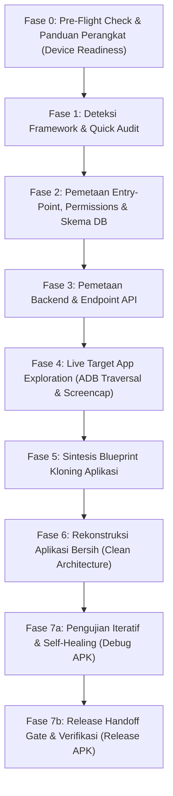

# Android APK Reverse Engineering, Live UI Traversal & Blueprint Synthesis (apkx)

> [!CAUTION] ZERO-RAW-ADB MANDATE
> DILARANG KERAS memanggil perintah shell `adb ...` secara manual melalui terminal/bash. Seluruh inspeksi, dump UI, instalasi, pengujian interaksi, dan diagnostik perangkat wajib 100% menggunakan MCP tool `apkx_*`. Jika Anda membutuhkan data sistem atau status perangkat, gunakan `apkx_diagnostics`, `apkx_get_current_screen`, `apkx_dump_ui_hierarchy`, atau `apkx_get_app_logs`.

Tujuan utama skill ini adalah memandu AI Agent dalam menganalisis berkas APK/APKS hasil ekstraksi `apkx` secara metodis, mengekstrak arsitektur inti aplikasi, memetakan skema database (termasuk SQLite di `libapp.so`), menjelajahi seluruh fitur UI aplikasi target secara langsung di ponsel melalui ADB (*screencap & tap*), menyusun cetak biru (*blueprint*) arsitektur, dan memverifikasi aplikasi hasil kloningan langsung di perangkat fisik dengan siklus perbaikan mandiri (*Self-Healing Loop*).

---

## 1. Prinsip Utama: Clean-Room Reverse Engineering & Verification

1. **Evidence-Based (Berbasis Bukti):** Jangan pernah menebak struktur data, endpoint API, atau logika bisnis jika Anda bisa memverifikasinya langsung dari artefak `apkx` (Manifest, `endpoints.json`, `class_skeleton.txt`, `sqlite_schema.sql`, atau dekompilasi JADX).
2. **Live Visual Grounding (Eksplorasi Layar Nyata):** Blueprint statis tidak menggambarkan alur UX secara utuh. Buka aplikasi target di ponsel via ADB, ambil screenshot untuk tiap tab dan modal, lalu gunakan penalaran visual multimodal AI untuk mengidentifikasi tata letak, warna, dan kelemahan UI aplikasi asli.
3. **Clean-Room Reimplementation:** Hasil reverse engineering digunakan sebagai acuan arsitektur (kontrak API, model data, dan alur UI), kemudian dibangun ulang secara bersih menggunakan standar framework target (misalnya menerapkan *Flutter Anti-Slop*).
4. **Autonomous Runtime Verification (2-Stage Deployment):** Jangan anggap pekerjaan selesai sebelum aplikasi yang dibangun berhasil diuji coba pada versi debug dan diganti dengan versi release siap produksi yang terverifikasi bebas bug.

---

## 2. Alur Kerja Utama 8 Fase (8-Phase Master Workflow)

---

### Fase 0: Pre-Flight Check & Panduan Perangkat (Device Readiness)
Sebelum mengeksekusi operasi perangkat apa pun (seperti `apkx_list_apps`, `apkx_pull_and_extract`, atau live UI traversal), AI Agent **WAJIB** memverifikasi kesiapan perangkat:

1. **Jalankan Pre-Flight Check:**
   Panggil tool **`apkx_list_devices()`**.
   Tool ini memeriksa koneksi ADB dan mengembalikan status kesiapan:
   * **`status == "ready"` (`code == "READY"`):** Perangkat terhubung, diizinkan, dan siap digunakan. Agen dapat melanjutkan langsung ke Fase 1.
   * **`code == "NO_DEVICE"`:** Tidak ada perangkat Android atau emulator yang terdeteksi via ADB.
   * **`code == "UNAUTHORIZED"`:** Perangkat terhubung namun belum diizinkan (menunggu konfirmasi otorisasi RSA di layar HP).
   * **`code == "OFFLINE"`:** Perangkat terhubung namun berstatus offline.

2. **Protokol Agen Jika Perangkat Tidak Terdeteksi (`NO_DEVICE`):**
   * **JANGAN** melanjutkan ke langkah ekstraksi/analisis perangkat atau memanggil tool ADB lainnya.
   * **JANGAN** mengeluarkan pesan error mentah teknis (`ADBError: no devices found`).
   * **Sampaikan pesan panduan ramah, jelas, dan santun** kepada pengguna dengan 4 langkah berikut:
     > "Halo! Saya mendeteksi belum ada perangkat Android yang terhubung via ADB. Agar proses analisis atau pengujian aplikasi dapat berjalan langsung di ponsel, mohon ikuti 4 langkah cepat berikut:
     > 1. Hubungkan HP Android ke komputer menggunakan kabel data USB (atau jalankan emulator Android).
     > 2. Aktifkan **Opsi Pengembang (Developer Options)** dan hidupkan **USB Debugging** di Pengaturan HP.
     > 3. Buka layar HP dan periksa dialog USB Debugging lalu pilih **Izinkan / Allow** (centang 'Selalu izinkan dari komputer ini').
     > 4. Balas chat ini dengan *'sudah siap'* atau hubungi saya kembali jika perangkat sudah terpasang.
     >
     > *(Catatan: Jika Anda sudah memiliki file APK di komputer, Anda juga bisa memberikannya langsung kepada saya untuk dianalisis secara offline tanpa HP!)*"

3. **Protokol Agen Jika Perangkat Belum Diizinkan (`UNAUTHORIZED`):**
   * Minta pengguna membuka kunci layar ponsel dan menekan tombol **"Allow / Izinkan"** pada dialog konfirmasi USB Debugging.

---

### Fase 1: Deteksi Framework & Quick Audit
Sebelum memeriksa kode secara mendalam, kenali teknologi dasar aplikasi target:

1. **Cari Aplikasi Terpasang via `apkx_list_apps(query="...")`:**
   Gunakan parameter `query` untuk menyaring aplikasi berdasarkan substring nama atau package secara efisien.
2. **Jalankan `apkx_get_app_info(package_name)`** untuk melihat:
   * `targetSdk`, `minSdk`, versi aplikasi, dan lokasi file APK di ponsel.
   * Format aplikasi (Single APK vs Split-APK/App Bundle).
3. **Tarik dan Ekstrak Berkas via `apkx_pull_and_extract(query_or_package)`**:
   * Periksa Framework terdeteksi di `README_ANALISIS.txt` atau `analysis_info.json`:
     * **Flutter:** Memiliki `libflutter.so` dan `libapp.so`. Logika di compiled native AOT `libapp.so`.
     * **React Native:** Memiliki `index.android.bundle` (Hermes bytecode `.hbc` atau Plain JS).
     * **Java/Kotlin Native:** Menggunakan pure DEX bytecode multi-split.
     * **Unity:** Game berbasis engine Unity (`libunity.so` / `bin/Data`).

---

### Fase 2: Pemetaan Entry-Point, Permissions & Skema Database

1. **Baca Manifest Terdekode (`apkx_get_manifest(target_path)`):**
   * Cari **Main Launcher Activity** (`android.intent.action.MAIN` + `android.intent.category.LAUNCHER`) untuk mengetahui entry point saat aplikasi diluncurkan.
   * Identifikasi Deep Links & skema URL (`<data android:scheme="..." android:host="..."/>`).
   * Audit izin (*permissions*) sensitif (`CAMERA`, `ACCESS_FINE_LOCATION`, `POST_NOTIFICATIONS`).
2. **Ekstraksi Skema Database (SQLite / ORM):**
   * Gunakan tool **`apkx_extract_sqlite_schema(target_path)`** atau periksa `sqlite_schema.sql`.
   * Pada aplikasi Flutter, tabel-tabel SQLite (`account`, `category`, `transaction`, `user`, dll.) tertanam dalam biner `libapp.so` dan otomatis terekstrak ke file `sqlite_schema.json`.

---

### Fase 3: Pemetaan Backend & API Endpoints

Gunakan tool **`apkx_search_endpoints(target_path, query=...)`**:
1. **Cari Domain Utama:** Identifikasi base URL backend utama aplikasi vs domain analitik pihak ketiga.
2. **Cari Endpoint Fitur:**
   * Otentikasi: `query="auth"` atau `query="login"`.
   * API Versi: `query="/v1/"` atau `query="/v2/"`.
   * Fitur Utama: `query="user"`, `query="product"`, `query="transaction"`.
3. Formatkan ke dalam tabel kontrak API (Metode, URL, Perkiraan Payload).

---

### Fase 4: Live Target App Exploration (ADB Traversal & Screencap)
Buka aplikasi target di HP yang terhubung untuk memetakan seluruh antarmuka dan menangkap cacat desain aplikasi asli:

1. **Pastikan Layar Menyala & Tidak Terkunci:**
   * Panggil tool **`apkx_ensure_device_awake()`** terlebih dahulu. Tool ini mengaktifkan mode *Stay Awake via USB*, membangunkan layar, dan membuka kunci swipe/PIN otomatis.
2. **Buka Aplikasi Target & Cek Layar Aktif:**
   * Panggil tool **`apkx_launch_app(package_name, restart=True)`**.
   * Verifikasi Activity yang sedang tampil di layar menggunakan **`apkx_get_current_screen(expected_package=package_name)`** untuk memastikan aplikasi berhasil berada di latar depan (*foreground*).
3. **Ambil Tangkapan Layar Berkecepatan Tinggi:**
   * Panggil **`apkx_take_screenshot(output_path="output/screen_target_home.png")`**.
   * Baca file gambar menggunakan tool `Read` untuk penalaran visual multimodal.
4. **Penjelajahan Matriks Antarmuka Sistematis (Full Feature Traversal):**
   * **Bottom Navigation Bar:** Berpindah ke setiap tab dengan memanggil `apkx_interact(action="tap", x=..., y=...)` dan ambil screenshot untuk setiap tab:
     * `screen_target_tab_transaksi.png`
     * `screen_target_tab_bagan.png`
     * `screen_target_tab_akun.png`
     * `screen_target_tab_setelan.png`
   * **Floating Action Button (FAB / +):** Tap tombol tambah aksi untuk menangkap form transaksi / modal dialog (`screen_target_add.png`).
   * **Drawer Menu / Header:** Tap menu samping atau filter tanggal di header atas.
   * **Pencarian Elemen Semantik UI:** Gunakan **`apkx_find_ui_element(query="Simpan")`** untuk mendapatkan posisi koordinat tengah tombol secara presisi tanpa perlu menghitung manual dari XML dump mentah.
   * **Inspeksi Bounding Box Menyeluruh:** Panggil **`apkx_dump_ui_hierarchy()`** jika membutuhkan seluruh pohon elemen layar.
   * **Navigasi Kembali Aman:** Gunakan `apkx_interact(action="back")` untuk menutup dialog/keyboard.
5. **Audit Kelemahan UI/UX Aplikasi Asli:**
   Catat kelemahan visual aplikasi target untuk diperbaiki pada aplikasi baru:
   * *Kontras Buruk:* Teks gelap di atas background gelap (tidak lolos WCAG AAA).
   * *Teks Terpotong:* Label teks panjang yang terpotong secara canggung.
   * *Tabrakan Elemen:* Tombol melayang yang menutupi kartu atau form input.
   * *Dead Space:* Ruang kosong masif yang tidak dimanfaatkan.

---

### Fase 5: Sintesis Blueprint Kloning Aplikasi
Susun dokumen ringkasan Blueprint Arsitektur:
1. **Ringkasan Identitas Aplikasi** (Nama, Package ID, Framework asal).
2. **Pohon Arsitektur Fitur** (Auth, Beranda, Fitur Inti, Pengaturan).
3. **Kontrak API & Skema Model Data** (Entity / DTO lengkap).
4. **Daftar Peningkatan UI/UX** (Perbaikan kelemahan yang ditemukan di Fase 4).

---

### Fase 6: Rekonstruksi Aplikasi Bersih (Clean Architecture)
Bangun aplikasi target baru (misal Flutter):
1. Terapkan Clean Architecture (Theme, Core Utils, Database, Models, Providers, Widgets, Screens).
2. Terapkan prinsip mobile ergonomics (*Thumb Zone*, target sentuh minimal 48dp, 4-state architecture: Shimmer, Empty, Error, Success).
3. Jalankan verifikasi statis:
   * `flutter analyze` (pastikan 0 warnings / errors).
   * `flutter test` (pastikan seluruh widget & unit test lolos 100%).

---

### Fase 7a: Pengujian Iteratif & Self-Healing (Debug APK)
Selama fase pengembangan dan perbaikan cepat (debugging), pasang versi debug untuk memvalidasi fungsionalitas dan memperbaiki error secara otonom:

1. **Bangun APK Debug:**
   Eksekusi perintah build: `flutter build apk --debug`.
2. **Pemasangan via MCP:**
   Panggil tool **`apkx_install_apk(apk_path="build/app/outputs/flutter-apk/app-debug.apk", allow_downgrade=True, reinstall=True)`**.
   *Jika terjadi konflik signature (`UPDATE_INCOMPATIBLE`), panggil `apkx_uninstall_app(package_name=new_package_name)` lalu pasang kembali.*
3. **Peluncuran & Verifikasi Layar Pertama:**
   * Pastikan layar menyala dan tidak terkunci via **`apkx_ensure_device_awake()`**.
   * Buka aplikasi via **`apkx_launch_app(package_name=new_package_name, restart=True)`**.
   * Verifikasi Activity yang aktif di layar via **`apkx_get_current_screen(expected_package=new_package_name)`**. Pastikan `is_target_foreground == True`.
   * Ambil tangkapan layar via **`apkx_take_screenshot(output_path="output/screen_debug_home.png")`** dan baca hasilnya via `Read`.
4. **Simulasi Interaksi End-to-End:**
   * Uji seluruh alur navigasi dan form input:
     - Cari elemen tombol secara semantik via **`apkx_find_ui_element(query="...")`** untuk mendapatkan titik tengah `[center_x, center_y]`.
     - Tap elemen via `apkx_interact(action="tap", x=center[0], y=center[1])`.
     - Ketik teks pada form via `apkx_interact(action="text", text="...")`.
     - Hapus input jika perlu via `apkx_interact(action="backspace", count=N)`.
     - Tekan lama item via `apkx_interact(action="long_press", x=..., y=..., duration_ms=1000)`.
     - Alihkan aplikasi via `apkx_interact(action="recent_apps")`.
   * Jika aplikasi meminta izin runtime (kamera, notifikasi, storage), gunakan **`apkx_grant_permission(package_name=new_package_name, permission="android.permission.CAMERA")`**.
5. **Siklus Perbaikan Mandiri (Self-Healing Loop):**
   * Jika terjadi crash, layar putih, atau exception:
     1. Ambil logcat tertarget via **`apkx_get_app_logs(package_name=new_package_name, lines=200)`**.
     2. Perbaiki kode sumber yang bermasalah.
     3. Kompilasi ulang (`flutter build apk --debug`) dan pasang kembali via `apkx_install_apk(...)`.
     4. Ulangi pengujian sampai seluruh fitur berjalan tanpa error.

---

### Fase 7b: Release Handoff Gate (WAJIB - Release APK)
Setelah aplikasi terbukti berjalan stabil pada versi debug, AI Agent **WAJIB** mengganti instalasi perangkat ke versi Release agar pengguna mendapatkan performa produksi maksimal:

1. **Bersihkan Instalasi Debug Lama:**
   Panggil **`apkx_uninstall_app(package_name=new_package_name, keep_data=False)`** untuk mencegah kegagalan akibat bentrok signature kunci debug vs release (`UPDATE_INCOMPATIBLE`).
2. **Kompilasi APK Siap Release:**
   Eksekusi perintah kompilasi produksi: `flutter build apk --release`.
   *(Pastikan biner output berada di `build/app/outputs/flutter-apk/app-release.apk`)*.
3. **Pemasangan Versi Release:**
   Panggil tool **`apkx_install_apk(apk_path="build/app/outputs/flutter-apk/app-release.apk", allow_downgrade=False, reinstall=True, verify=True)`**.
   *Tangani overlay Play Protect jika muncul (lihat SOP di bawah).*
4. **Gerbang Verifikasi Release (Release Gate Verification - WAJIB):**
   Panggil **`apkx_verify_install(package_name=new_package_name, expect_release=True)`**.
   * Evaluasi hasil pengujian:
     - **`verified == True`** dan **`debuggable == False`**: Pemasangan versi release SUKSES dan tervalidasi penuh.
     - **`debuggable == True`**: GAGAL! Aplikasi di perangkat masih berstatus debug. Segera ulangi langkah uninstall dan pastikan build release dipasang.
     - **`verified == False`**: GAGAL! Paket belum terpasang dengan benar di perangkat.
5. **Uji Asap Terakhir (Final Smoke Test):**
   * Buka aplikasi release via **`apkx_launch_app(package_name=new_package_name, restart=True)`**.
   * Verifikasi latar depan via **`apkx_get_current_screen(expected_package=new_package_name)`**.
   * Ambil tangkapan layar bukti final via **`apkx_take_screenshot(output_path="output/screen_final_release.png")`**.

---

### SOP Penanganan Google Play Protect Dialog / Overlay
Saat memasang APK release tanpa tanda tangan Google Play Store, Android atau Google Play Services dapat menampilkan dialog/overlay transparan pemblokir (`com.android.vending.transparentmainactivity.HsdpAlias` atau dialog "Unsafe app blocked"):

1. **Deteksi Overlay:**
   Panggil **`apkx_get_current_screen(expected_package=new_package_name)`**.
   Jika `is_overlay_active == True` atau `package_name == "com.android.vending"`:
2. **Interaksi Dialog UI:**
   * Cari opsi rincian: `apkx_find_ui_element(query="More details")` atau variasi teks bahasa lokal ("Rincian selengkapnya", "Detail").
   * Jika ditemukan, lakukan tap pada koordinat tengah: `apkx_interact(action="tap", x=center[0], y=center[1])`.
   * Cari tombol lanjutkan: `apkx_find_ui_element(query="Install anyway")` atau "Tetap instal".
   * Jika ditemukan, lakukan tap: `apkx_interact(action="tap", x=center[0], y=center[1])`.
3. **Penutupan Overlay Aman:**
   Jika dialog/overlay Play Protect masih menutupi layar setelah instalasi selesai, tutup overlay tersebut menggunakan tool:
   **`apkx_force_stop_app(package_name="com.android.vending")`**.
   > [!WARNING] PERINGATAN KESELAMATAN
   > Dilarang mencoba perintah modifikasi pengaturan global seperti `settings put global verifier_verify_adb_installs 0`. Selalu gunakan alur interaksi semantik UI atau `apkx_force_stop_app` di atas.

---

## 3. Ringkasan Toolkit MCP untuk Otomasi Agen

| Tool MCP | Parameter Kunci | Fungsi Utama |
| :--- | :--- | :--- |
| `apkx_list_devices` | *(none)* | Pre-flight check & status kesiapan HP terhubung lengkap dengan hardware specs |
| `apkx_list_apps` | `query`, `include_system_apps`, `device_id` | Daftar aplikasi terpasang dengan filter query cepat |
| `apkx_get_app_info` | `package_name`, `device_id` | Audit teknis cepat (versi, SDK, permission) tanpa unduh APK |
| `apkx_pull_and_extract` | `package_name`, `output_dir`, `device_id` | Tarik APK/APKS & ekstrak seluruh artefak blueprint |
| `apkx_get_manifest` | `target_path` | Baca AndroidManifest.xml terdekode dari direktori atau berkas APK/APKS |
| `apkx_get_endpoints` | `target_path` | Ekstrak seluruh backend URL dan domain dari berkas analisis |
| `apkx_search_endpoints` | `target_path`, `query` | Cari rute API spesifik (auth, v1, users) |
| `apkx_get_class_skeleton`| `target_path`, `max_lines` | Struktur kelas & modul DEX tanpa token bloat |
| `apkx_inspect_class` | `target_path`, `class_name` | Dekompilasi on-demand 1 kelas via JADX |
| `apkx_find_classes` | `target_path`, `query` | Cari kelas kunci (Repository, ViewModel, Auth) |
| **`apkx_extract_sqlite_schema`** | `target_path` | **Ekstrak tabel & kolom SQLite dari `libapp.so` / DEX** |
| **`apkx_install_apk`** | `apk_path`, `reinstall`, `grant_permissions`, `allow_downgrade`, `verify` | **Pasang file APK ke perangkat fisik (default safe release, verifikasi otomatis & diagnosa error)** |
| **`apkx_uninstall_app`** | `package_name`, `keep_data`, `device_id` | **Hapus instalasi aplikasi dari perangkat untuk reinstall bersih** |
| **`apkx_launch_app`** | `package_name`, `activity_name`, `restart`, `device_id` | **Buka aplikasi target/kloningan di HP (`am start -S`)** |
| **`apkx_take_screenshot`** | `output_path`, `device_id` | **Ambil tangkapan layar perangkat berkecepatan tinggi** |
| **`apkx_dump_ui_hierarchy`** | `compressed`, `device_id` | **Dapatkan posisi tengah `[center_x, center_y]` seluruh elemen UI** |
| **`apkx_find_ui_element`** | `query`, `by`, `exact`, `case_sensitive`, `device_id` | **Pencarian elemen UI semantik berdasarkan teks, ID, deskripsi atau kelas dengan kalkulasi koordinat otomatis** |
| **`apkx_interact`** | `action`, `x`, `y`, `duration_ms`, `count`, `text`, `device_id` | **Eksekusi tap, long_press, back, home, recent_apps, backspace, swipe, atau input teks** |
| **`apkx_ensure_device_awake`** | `device_id` | **Bangunkan layar, auto-unlock PIN/swipe, aktifkan stay awake** |
| **`apkx_get_current_screen`** | `expected_package`, `device_id` | **Deteksi Activity, PID, status overlay (Play Protect), dan verifikasi foreground** |
| **`apkx_get_app_logs`** | `package_name`, `lines`, `device_id` | **Perekam log error & crash tertarget khusus aplikasi target** |
| **`apkx_reset_app_data`** | `package_name`, `device_id` | **Reset data instan (`pm clear`) untuk uji fresh-install state** |
| **`apkx_open_deep_link`** | `url`, `device_id` | **Lompat langsung ke sub-layar via URL/Deep Link Intent** |
| **`apkx_toggle_night_mode`** | `enable`, `device_id` | **Uji responsivitas tema sistem Dark Mode vs Light Mode** |
| **`apkx_diagnostics`** | `action`, `package_name`, `prop_name`, `category`, `device_id` | **Inspeksi sistem aman allowlist (battery, meminfo, getprop, disk, display, package_path, network)** |
| **`apkx_force_stop_app`** | `package_name`, `device_id` | **Hentikan paksa aplikasi latar belakang atau overlay nakal dengan proteksi sistem** |
| **`apkx_verify_install`** | `package_name`, `expect_release`, `device_id` | **Verifikasi status instalasi, flags paket, dan konfirmasi rilis produksi (debuggable=False)** |
| **`apkx_grant_permission`** | `package_name`, `permission`, `device_id` | **Berikan izin runtime Android secara selektif dengan normalisasi nama** |

---

## 4. Orkestrasi Swarm Multi-Agent (Antigravity v1.5.5+)

Ketika AI Agent diminta melakukan analisis mendalam atau merekonstruksi/mengkloning aplikasi secara komprehensif, manfaatkan fitur **Swarm (`/swarm`)** untuk membagi beban kerja secara terkoordinasi.

### A. Protokol Mutlak: Single-Device-Controller
> [!CAUTION] PROTOKOL SINGLE-DEVICE-CONTROLLER
> Perangkat fisik Android terhubung melalui satu port USB / socket ADB. DILARANG KERAS membiarkan lebih dari 1 worker memanggil tool MCP perangkat (`apkx_*`) secara bersamaan. Hanya satu agen yang memegang status aktif pada perangkat pada satu waktu:
> - **Fase Awal (Fase 0 s.d. 4):** Dikendalikan eksklusif oleh **`device-runner`**.
> - **Fase Rekonstruksi (Fase 6):** Akses perangkat di-pause. Seluruh builder bekerja paralel di software tanpa menyentuh ADB.
> - **Fase Pengujian HP (Fase 7a/7b):** Dikendalikan eksklusif oleh **`live-tester`**.

### B. Daftar Roster & Tanggung Jawab Anggota Swarm

1. **`coordinator` (Queen / Orchestrator):**
   * Membuka swarm, membagi tugas di papan pesan (*shared message board*), memantau kemajuan, dan melapor ke user.
   * **Tidak menulis kode aplikasi** agar tetap responsif mengelola antrean.
2. **`device-runner` (Hardware Specialist - Eksplorasi):**
   * Memegang kendali eksklusif ADB pada Fase 0 s.d. 4.
   * Menjalankan `apkx_list_devices`, `apkx_pull_and_extract`, meluncurkan target app di HP, menjelajahi layar utama, dan mengambil screenshot referensi (`apkx_take_screenshot`).
3. **`code-analyst` (Static Reverse Engineer):**
   * Mengurai manifest biner, skema SQLite (`apkx_extract_sqlite_schema`), backend endpoints (`apkx_get_endpoints`), dan class skeleton DEX.
   * Memposting kontrak arsitektur (tabel DB, DTO, endpoints) ke papan pesan.
4. **`builder-data` (Author - `workspace: "share"`):**
   * Membangun local database layer (Drift/SQLite/Room), data models, DAOs, dan repository data.
5. **`builder-api` (Author - `workspace: "share"`):**
   * Membangun network layer (Dio/Retrofit), HTTP service, DTO serialization, dan error handling.
6. **`builder-ui` (Author - `workspace: "share"`):**
   * Membangun themes, styling, widgets, dan screens berdasarkan screenshot visual target app dengan menerapkan mobile ergonomics (Thumb-Zone, anti-slop).
7. **`code-verifier` (Auditor - `workspace: "share"`):**
   * Menjalankan static analysis (`flutter analyze` / `lint`) dan unit tests. Memastikan 0 errors/warnings sebelum build APK dimulai.
8. **`live-tester` (Hardware Specialist - Dynamic QA & Deployment):**
   * Mengambil alih perangkat fisik pada Fase 7a & 7b.
   * Membangun APK, memasang ke HP (`apkx_install_apk`), menangani overlay Google Play Protect, melakukan pengujian sentuh end-to-end, memantau crash logcat (`apkx_get_app_logs`), dan memvalidasi APK release (`apkx_verify_install`).

### C. Alur Handoff & Self-Healing Lintas Agen
1. **Handoff ke Builder:** Setelah `device-runner` memposting screenshot dan `code-analyst` memposting skema, `coordinator` menugaskan ketiga builder secara simultan di `workspace: "share"`.
2. **Handoff ke Verifier:** Ketika builder selesai, `code-verifier` menjalankan audit statis.
3. **Handoff ke Device QA:** Setelah kode bersih, `live-tester` memasang APK ke ponsel fisik dan menguji alur pengguna.
4. **Autonomous Self-Healing Loop:** Jika `live-tester` menemukan exception/crash di HP via `apkx_get_app_logs`, ia memposting cuplikan error dan me-mention builder terkait di board. Builder memperbaiki kodenya, `code-verifier` memvalidasi ulang, dan `live-tester` menguji ulang di HP secara otomatis.
